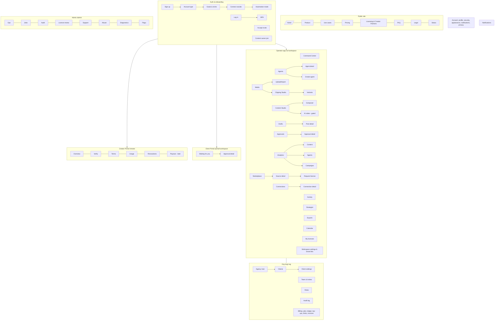
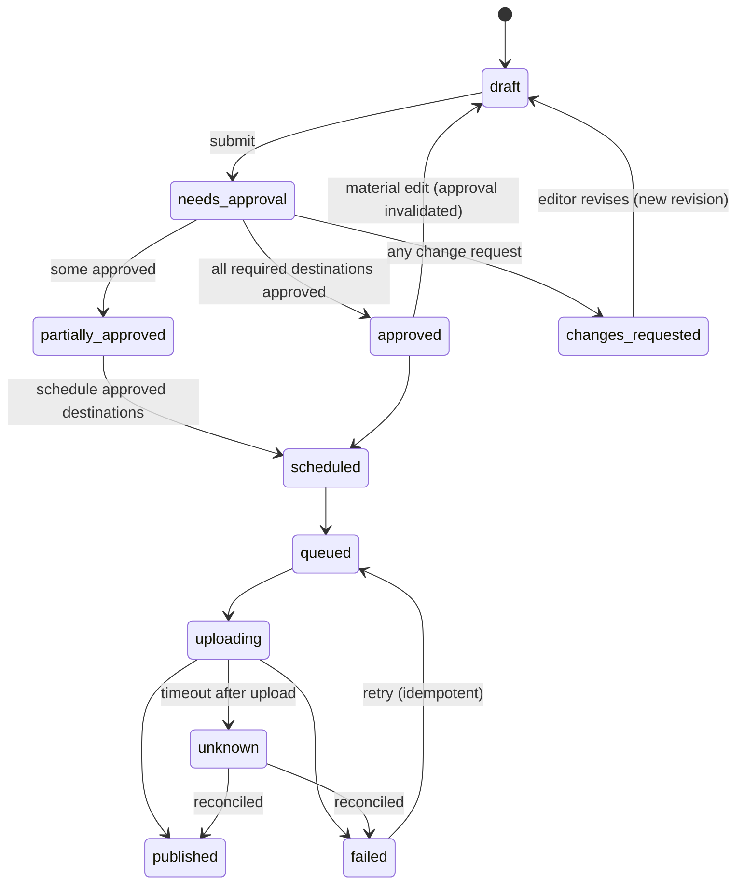
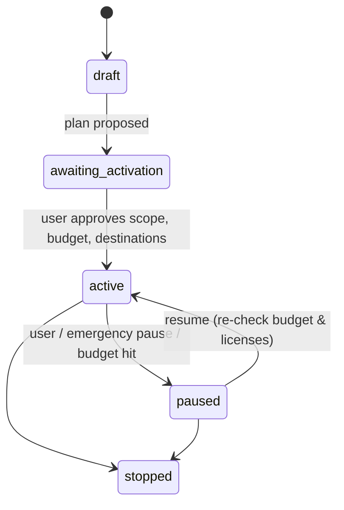

# Nelio — Design Deliverable B: Information Architecture, Sitemap, Permissions & Journeys

**Phase:** Design (Master Prompt 1) — checkpoint B of A–H
**Date:** 12 November 2026
**Status:** Draft for review. Builds on `A_REQUIREMENTS_INVENTORY.md`; screen IDs (M-01, APP-03, …), role IDs (R-CR, …) and journey IDs (J-01, …) refer to it.

---

## 1. IA principles

1. **Workspace is the unit of work.** Agents, content, accounts, approvals and activity always belong to one workspace. The current workspace is always visible.
2. **Organization is the unit of ownership and money.** Billing, plan, team and (for agencies) client workspaces live at org level. Solo creators never see the word "organization": org pages appear under **Settings → Billing / Team**.
3. **The Command Center is home.** The product is an AI workforce, so the first screen after login shows what agents are doing, what needs you and what it costs. It is not a file browser.
4. **"Needs you" is always one click away.** Pending approvals, blocked agents, failed publishes, expiring licenses and spend warnings collect in one place (the Command Center "Needs attention" panel and the notification inbox).
5. **Separate surfaces for people who aren't operators.** Client approvers get a **Client Portal**; licensed content owners get a **Creator Portal**; platform staff get **Admin**. None of them see the operator navigation.
6. **Honest states are part of the IA.** Every integration, AI and payment surface has a defined place for "mock", "not connected", "pending approval", "coming later" and "unknown" (A §5).

---

## 2. Surfaces (layouts)

| Surface | Who | Layout | Entry |
|---|---|---|---|
| **Public site** | Everyone | Marketing header + footer | `/` |
| **Auth & onboarding** | New / signed-out users | Centered card, progress bar on onboarding | `/login`, `/signup` |
| **Operator app** | R-CR, R-BO, R-AO, R-AA, R-WM, R-ED, R-AV | Sidebar + top bar (desktop); bottom tabs (mobile) | `/w/[workspace]/home` |
| **Agency org area** | R-AO, R-AA | Operator layout, org-level sidebar section | `/org/[org]` |
| **Client Portal** | R-CA | Minimal header (agency logo + workspace name), no sidebar | `/portal/[workspace]` |
| **Creator Portal** | R-CO | Own sidebar, licensing-only | `/creator` |
| **Platform Admin** | R-PA | Distinct admin chrome (contrasting header strip, "Admin" badge, audited-session banner) | `/admin` |

A user can hold roles in several surfaces at once (e.g. an agency owner who is also a licensed content owner). The **account menu** lists every surface the user can enter.

---

## 3. Navigation model

### 3.1 Operator app — desktop

**Top bar (left → right):** Workspace switcher (APP-07) · Command palette / search (`⌘K` / `Ctrl K`) · *spacer* · Credits meter (opens BI-01) · Emergency pause (workspace) · Notifications bell (NT-01) · Account menu (profile, appearance, surfaces, sign out).

**Sidebar (grouped):**

| Group | Items | Screen |
|---|---|---|
| — | **Command Center** | APP-01 |
| — | **Activity** | APP-03 |
| **AI** | Strategist · Agents | APP-02 · APP-04 |
| **Create** | Clipping Studio (Media) · Content Studio · Exports | CL-01 · CS-01 · CL-05 |
| **Publish** | Calendar · Drafts · Approvals (badge count) | PB-01 · PB-02 · PB-04 |
| **Grow** | Analytics · Licensing | AN-01 · LI-01 |
| **Workspace** | Connections · Brand kits · Settings | IN-01 · ST-06 · ST-10 |
| **Agency** *(agency orgs only)* | Agency hub · Clients · Team · Audit log | AG-01 · AG-02 · AG-04 · AG-06 |
| *footer* | Billing & usage · Help | BI-01 · — |

Items the current role can't use are **hidden**, not disabled (avoids clutter). Items the current **plan** doesn't include are **shown with a lock** and lead to an upgrade explanation (drives J-09 conversion honestly).

### 3.2 Operator app — mobile (< 768 px)

**Bottom tab bar (5):** Home (APP-01) · Activity (APP-03) · **Approvals** (PB-04, badge) · Calendar (PB-01) · More (sheet with the rest of the sidebar).

Mobile is optimised for **monitoring, approving, pausing and light editing**. The Clipping Studio on mobile is a focused **review-and-trim** mode: pick candidate, trim handles, caption style preset, preview, approve/export. Multi-track timeline editing is desktop/tablet only, with a clear "Open on a larger screen for full editing" note.

### 3.3 Tablet (768–1279 px)

Sidebar collapses to icons; Clipping Studio uses two panes (preview + transcript) with candidates in a drawer.

### 3.4 Client Portal

Header: agency logo, workspace name, notifications, account. Body tabs: **Waiting for you** · **Approved** · **Changes requested** · **Published**. No billing, credentials, agents or other clients. Designed mobile-first, since clients approve on their phones.

### 3.5 Creator Portal

Sidebar: Overview (LI-05) · Verification (LI-06) · Licensing terms (LI-07) · Usage (LI-08) · Revocations (LI-09) · Payouts (LI-10, "coming later").

### 3.6 Admin

Sidebar: Ops overview (AD-01) · Jobs & dead-letter (AD-02) · Audit search (AD-03) · License review (AD-04) · Support access (AD-05) · Abuse & moderation (AD-06) · Diagnostics (AD-07) · Feature flags (AD-08). Every admin page shows "Your actions here are audited."

### 3.7 Global patterns

- **Command palette (`⌘K`):** jump to any screen, agent, post or client; quick actions ("Pause all agents", "New upload", "Create agent").
- **Deep links:** every notification opens the exact object (e.g. `/w/acme/approvals/apr_123?destination=instagram`).
- **Breadcrumbs** on detail screens: `Workspace › Section › Object`.
- **Prototype only:** a floating **Demo persona** switcher (A AS-8) and a persistent "Prototype — mock data" ribbon.

---

## 4. Sitemap

---

## 5. Route inventory

Next.js App Router paths. `[ws]` = workspace slug, `[org]` = organization slug. This list becomes the prototype's route map (F) and the build phase's page list.

### 5.1 Public & auth

| Route | Screen | Notes |
|---|---|---|
| `/` | M-01 | |
| `/product` | M-02 | |
| `/use-cases/creators` · `/businesses` · `/agencies` | M-03 | |
| `/pricing` | M-04 | Provisional-entitlement note |
| `/licensing` | M-05 | Content-owner CTA → `/creators/join` |
| `/faq` | M-06 | |
| `/legal/[terms\|privacy\|acceptable-use\|licensing-policy\|takedown]` | M-07 | Placeholder copy (A AS-7) |
| `/status` | M-08 | Integration availability per platform |
| `/signup` · `/login` · `/verify-email` · `/reset-password` · `/mfa` | AU-01–05 | |
| `/invite/[token]` | AU-06 | Routes to operator app or Client Portal depending on role |
| `/creators/join` | AU-07 | No plan selection |
| `/onboarding/account-type` · `/goals` · `/connect` · `/automation` | ON-01–04 | "Skip for now" on each; progress 1–4 |

### 5.2 Operator app (`/w/[ws]/…`)

| Route | Screen | Route | Screen |
|---|---|---|---|
| `/home` | APP-01 (+ ON-05 checklist) | `/calendar` | PB-01 |
| `/strategist` | APP-02 | `/drafts` | PB-02 |
| `/activity` | APP-03 | `/posts/[id]` | PB-03 |
| `/activity/[runId]` | APP-03 job drawer (deep-linkable) | `/approvals` | PB-04 |
| `/agents` | APP-04 | `/approvals/[id]` | PB-05 |
| `/agents/new` | APP-06 | `/analytics` | AN-01 |
| `/agents/[id]` (tabs: overview, policy, budget, runs, destinations) | APP-05 | `/analytics/content` · `/agents` · `/campaigns` | AN-02–04 |
| `/media` | CL-01 | `/licensing` | LI-01 |
| `/media/upload` | CL-02 | `/licensing/sources/[id]` | LI-02 |
| `/studio/[projectId]` | CL-03 | `/licensing/sources/[id]/request` | LI-03 |
| `/studio/[projectId]/variants` | CL-04 | `/licensing/mine` | LI-04 |
| `/exports` | CL-05 | `/connections` | IN-01 |
| `/content` | CS-01 | `/connections/[platform]` | IN-02 |
| `/content/compose` · `/content/compose/[draftId]` | CS-02 | `/settings` (general, emergency pause, timezone) | ST-10 |
| `/content/video-generation` | CS-03 (gated) | `/settings/brand-kits` | ST-06 |
| `/notifications` | NT-01 (full page) | `/settings/members` · `/settings/ai` · `/settings/integrations` | ST-05 · ST-07 · ST-08 |

### 5.3 Org, account, portals, admin, system

| Route | Screen |
|---|---|
| `/org/[org]` | AG-01 Agency hub |
| `/org/[org]/clients` · `/clients/new` · `/clients/[ws]` | AG-02 · AG-03 |
| `/org/[org]/team` · `/roles` · `/audit` | AG-04 · AG-05 · AG-06 |
| `/org/[org]/billing` · `/plans` · `/ledger` · `/top-up` · `/limits` · `/invoices` | BI-01 (+BI-07, BI-08 banners) · BI-02 · BI-03 · BI-04 · BI-05 · BI-06 |
| `/account/profile` · `/security` · `/appearance` · `/notifications` · `/privacy` | ST-01 · ST-02 · ST-03 · ST-04 · ST-09 |
| `/portal/[ws]` · `/portal/[ws]/approvals/[id]` | CP-01 · CP-02 |
| `/creator` · `/verify` · `/terms` · `/usage` · `/revocations` · `/payouts` | LI-05 · LI-06 · LI-07 · LI-08 · LI-09 · LI-10 |
| `/admin` · `/jobs` · `/audit` · `/licenses` · `/support` · `/abuse` · `/diagnostics` · `/flags` | AD-01 … AD-08 |
| `/offline` · `not-found` · `/denied` · `/maintenance` | SY-02 · SY-03 |

For solo creators and businesses the org routes are reached from **Settings → Billing / Team** and show no "clients" items.

---

## 6. Role & permission matrix

Legend: **F** full · **A** only in assigned workspaces · **O** own items only · **V** view only · **P** per-platform decision on assigned items · **R** request only (someone else approves) · **—** no access.
Columns: CR Creator · BO Business owner · AO Agency owner · AA Agency admin · WM Workspace manager · ED Editor · AV Analyst/Viewer · CA Client approver · CO Content owner · PA Platform admin.

| Capability | CR | BO | AO | AA | WM | ED | AV | CA | CO | PA |
|---|---|---|---|---|---|---|---|---|---|---|
| **Organization & billing** | | | | | | | | | | |
| View plan, usage, ledger | F | F | F | F | V | — | — | — | — | V¹ |
| Change plan, payment method, top-ups | F | F | F | F | — | — | — | — | — | — |
| Set org / workspace spend limits | F | F | F | F | R | — | — | — | — | — |
| Delete organization / transfer ownership | F | F | F | — | — | — | — | — | — | — |
| **Workspaces & team** | | | | | | | | | | |
| Create client workspaces | — | — | F | F | — | — | — | — | — | — |
| Invite / remove staff | — | F | F | F | A² | — | — | — | — | — |
| Invite / remove client approvers | — | — | F | F | A | — | — | — | — | — |
| Change roles | — | F | F | F³ | — | — | — | — | — | — |
| Set approval policy (incl. per-platform) | F | F | F | F | A | — | — | — | — | — |
| View audit log | F | F | F | F | A | — | — | — | — | F¹ |
| Workspace emergency pause | F | F | F | F | A | — | — | — | — | F¹ |
| **Social connections** | | | | | | | | | | |
| Connect / disconnect accounts | F | F | F | F | A | — | — | — | — | — |
| View connection status | F | F | F | F | A | A | A | — | — | V¹ |
| **Agents & strategy** | | | | | | | | | | |
| Use Strategist / propose plans | F | F | F | F | A | A | — | — | — | — |
| Activate agent / expand permissions | F | F | F | F | A | R | — | — | — | — |
| Authorize **autonomous publishing** | F⁴ | F⁴ | F⁴ | F⁴ | A⁴ | — | — | — | — | — |
| Pause / resume agent | F | F | F | F | A | A | — | — | — | F¹ |
| Set agent budget | F | F | F | F | A⁵ | — | — | — | — | — |
| View Activity Center | F | F | F | F | A | A | A | — | — | V¹ |
| **Media & content** | | | | | | | | | | |
| Upload / import (with rights declaration) | F | F | F | F | A | A | — | — | — | — |
| Edit clips, drafts, captions | F | F | F | F | A | A | — | — | — | — |
| Render / export (consumes credits) | F | F | F | F | A | A | — | — | — | — |
| Comment on drafts | F | F | F | F | A | A | A | A | — | — |
| **Approvals & publishing** | | | | | | | | | | |
| Submit for approval | F | F | F | F | A | A | — | — | — | — |
| Approve / reject / request changes | F⁶ | F⁶ | F⁶ | F⁶ | A⁶ | — | — | P | — | — |
| Schedule / publish approved content | F | F | F | F | A | A⁷ | — | — | — | — |
| Retry failed / reconcile unknown publish | F | F | F | F | A | A | — | — | — | F¹ |
| **Analytics** | V | V | V | V | A | A | A | V⁸ | — | V¹ |
| **Licensing (user side)** | | | | | | | | | | |
| Browse marketplace, view terms | F | F | F | F | A | A | — | — | — | V |
| Request / accept licenses | F | F | F | F | A | R | — | — | — | — |
| **Licensing (owner side)** | | | | | | | | | | |
| Verify channel, set terms, revoke | — | — | — | — | — | — | — | — | O | — |
| View usage of own content | — | — | — | — | — | — | — | — | O | — |
| Review / suspend licenses, handle takedowns | — | — | — | — | — | — | — | — | — | F¹ |
| **Platform admin** | | | | | | | | | | |
| Queue, jobs, flags, diagnostics | — | — | — | — | — | — | — | — | — | F¹ |
| Support access to a tenant | — | — | — | — | — | — | — | — | — | F⁹ |

Notes:
1. Platform admin actions are audited and shown with an admin banner. Admin never sees OAuth tokens or payment card data.
2. Workspace managers can invite Editors and Viewers to their assigned workspace only.
3. Agency admins cannot change or remove the Owner.
4. Only on paid plans or the trial (A D-11, D-12), via an explicit authorization dialog naming account, content types, caps and budget. Re-authorization is required if any of those widen.
5. Up to the limit set by Owner/Admin.
6. When a client approver is assigned, staff approval does **not** replace client approval (A AS-5): it's an internal review step before the client sees it.
7. Editors can schedule only content that has every required approval; they can't change approval policy.
8. Client approvers see published-post analytics for their workspace only, if the agency enables it (default off).
9. Time-boxed, reason required, the tenant owner is notified, and the session is recorded in the audit log.

**Isolation rule (AC-02):** every A-scoped permission is evaluated against the workspace ID of the object. A user assigned to client A gets **SY-03 "You don't have access to this workspace"** for any client-B URL, and client B never appears in their switcher, search, notifications or realtime feed.

---

## 7. Approval model (with per-platform decisions)

Q-4 is now answered: clients decide **per platform destination**.

- An **approval request** covers one content revision and one or more destinations (e.g. YouTube Shorts + Instagram Reels).
- Each destination has its own decision: `pending → approved | changes_requested | rejected`.
- A post **publishes only to approved destinations**. The others stay held, and the post shows a mixed status such as "Instagram approved · YouTube changes requested".
- **Invalidation rule (confirmed, AS-B1):** an edit to **shared media** (video cut, captions burned into the video, audio) invalidates every destination's approval. An edit to **one platform's** text (caption, title, hashtags) invalidates only that destination's approval.
- **Approval chain (optional):** internal review (WM or owner) → client. Default: internal review off, client required when assigned.
- **Deadlines (optional):** when set, a reminder goes out at 24 h and on the due date. A missed deadline **never** auto-approves; the post stays held (ARCH §11: "default to blocking").
- Every decision records actor, time, revision, destination and comment. History is immutable and shown on PB-05 and CP-02.

`partially_approved` is a post-level summary; each destination follows the A PE-06 publish states on its own.

---

## 8. Other state models

### 8.1 Agent and run (A PE-04)

Runs: `queued → running → awaiting_approval | completed | failed | cancelled`. A run blocked by a gate shows **blocked** with its reason (license, budget, connection, approval) and a single fix action.

### 8.2 Social connection (A MP1-11)

`not_connected → connecting → connected` with side states `permissions_needed`, `pending_app_approval`, `capability_unsupported` (e.g. "Scheduling not available via API for this account type") and `token_expired → reconnect`. Prototype platform availability (A D-06): **YouTube, Instagram** = "In development: mock connection". **TikTok, Facebook** = "Coming later".

### 8.3 License (user-side view)

`requested → active → expiring_soon (14 days) → expired` and `active → revoked`. Expired or revoked: new generation and publishes are blocked, affected drafts are flagged on LI-04 and PB-03, and published posts are flagged for review (J-05).

### 8.4 Plan & trial

`free ⇄ trial (3 days) → free | paid`, `paid → past_due (grace) → paid | downgraded`. A trial never converts to paid without an explicit checkout (A D-12).

---

## 9. Journey maps

Format: **Step · Actor · Screen · What happens · Gate / state · Notifications**. The prototype (F) will make each journey clickable end-to-end with mock data.

### J-01 Creator first run
| # | Actor | Screen | What happens | Gate / state | Notify |
|---|---|---|---|---|---|
| 1 | Creator | M-01 → AU-01 | Signs up (email or Google) | Email verification pending | Verify email |
| 2 | Creator | ON-01 | Picks **Creator** | Skippable | |
| 3 | Creator | ON-02 | Goals + niche (chips + free text) | Skippable | |
| 4 | Creator | ON-03 | Connect YouTube/Instagram (mock) or skip | Platform availability states | |
| 5 | Creator | ON-04 | Chooses **Assisted** (default). Autonomous needs a separate authorization dialog; Free plan shows it locked | D-05, D-11 | |
| 6 | Creator | APP-01 | Lands on Command Center with checklist: brand kit, first upload, first agent, connect account | Empty states with one primary CTA | |
| 7 | Creator | CL-02 | Uploads video, ticks "I own this or have permission", picks transcription mode, sees **credit estimate** | Rights declaration required; spend gate | |
| 8 | System | APP-03 | Steps: upload → probe → transcribe (Balanced) → scene detection → candidate ranking | Real step names, no fake % | Draft ready |
| 9 | Creator | CL-03 | Reviews ranked candidates (scores labelled "estimate"), trims, picks caption style, reframes 9:16 | | |
| 10 | Creator | CL-05 | Renders; downloads MP4 | Export count against trial | Render complete |
| 11 | Creator | CS-02 → PB-03 | Writes per-platform caption, schedules to connected account | Connection + license gate | |
| 12 | System | PB-03 | Mock publish → **published** (labelled mock) | | Published |
| 13 | Creator | AN-02 | Sees metrics with "last updated" and "not provided by platform" labels | | |

### J-02 Agency setup
| # | Actor | Screen | What happens | Gate / state | Notify |
|---|---|---|---|---|---|
| 1 | Agency owner | AU-01 → ON-01 | Picks **Agency** | | |
| 2 | Owner | ON-02–04 | Goals, optional connections, automation mode | | |
| 3 | Owner | AG-01 | Empty agency hub → "Add your first client" | Plan limit on client workspaces | |
| 4 | Owner | AG-02 | Creates "Acme Foods" client workspace (name, logo, timezone) | | |
| 5 | Owner | AG-03 | Approval policy: client approval **required**, **per-platform** on, optional deadline | | |
| 6 | Owner | AG-04 | Invites Editor (assigned: Acme) and Client approver (Acme) | Invite expires in 7 days | Invite emails |
| 7 | Client | AU-06 → CP-01 | Accepts invite, sets password; lands in Client Portal (empty: "Nothing waiting for you") | | |
| 8 | Owner | IN-01 (Acme) | Connects Acme's Instagram (mock) | Connection states | |
| 9 | Owner | AG-06 | Sees audit entries for each step | | |

### J-03 Agency approval with per-platform decisions
| # | Actor | Screen | What happens | Gate / state | Notify |
|---|---|---|---|---|---|
| 1 | Editor | CL-03 → CS-02 | Builds a clip; destinations: Instagram Reels + YouTube Shorts | | |
| 2 | Editor | PB-03 | Submits for approval (revision r1) | → needs_approval | Client: "Approval requested" |
| 3 | Client | CP-01 → CP-02 | Previews each platform mock-up; **approves Instagram**, **requests changes on YouTube** ("title too long") | Per-destination decisions | Editor: "Changes requested (YouTube)" |
| 4 | Editor | PB-05 | Sees mixed status; edits YouTube title only → r2 | Instagram approval **kept** (platform-only edit, AS-B1) | |
| 5 | Editor | PB-03 | Schedules Instagram now; resubmits YouTube | partially_approved | Client: "Revision ready" |
| 6 | Client | CP-02 | Approves YouTube r2 | approved | Editor: "Approved" |
| 7 | System | PB-03 | Publishes both (mock); records attempts | Pre-publish re-check: revision, approval, license, connection | Published |
| 8 | Owner | AG-06 | Audit shows every decision with revision + destination | | |

Variant: if the editor had **re-cut the video** in step 4, both destinations' approvals would be invalidated and the client asked again.

### J-04 Autonomous run
| # | Actor | Screen | What happens | Gate / state | Notify |
|---|---|---|---|---|---|
| 1 | User | APP-02 | Chats goal ("3 shorts/week on budgeting tips for Nigerian students") | | |
| 2 | Strategist (demo) | APP-02 | Proposes plan card: cadence, sources (licensed pool), destinations, weekly budget, approval mode | awaiting_activation | |
| 3 | User | APP-02 | Edits budget; approves plan → agent created | Permission expansion needs explicit approval | |
| 4 | User | Authorization dialog | Grants autonomous publishing for Instagram only, max 3 posts/week, ≤ N credits/week | D-05; paid/trial only | Security notice email |
| 5 | Agent | APP-03 | Scheduled run: research → rights check → clip → QA → (approval if policy) → schedule → publish | Each expensive step checks budget | Per policy |
| 6 | Agent | APP-03 | QA fails on one clip (captions overlap face) → regenerated, logged | | |
| 7 | User | APP-01 | Sees agent card: runs this week, spend vs budget, next run | | Weekly summary |

### J-05 License revocation
| # | Actor | Screen | What happens | Gate / state | Notify |
|---|---|---|---|---|---|
| 1 | Content owner | LI-09 | Revokes license for "Channel X" (reason optional), confirms impact preview | | |
| 2 | System | — | License → revoked; new jobs blocked; scheduled posts held | Hard gate | Affected workspaces: "License revoked" |
| 3 | User | LI-04 | Sees revoked license, list of affected drafts, scheduled posts and published posts | | |
| 4 | User | PB-03 | Held post shows "Blocked: license revoked" with "Remove from schedule" | | |
| 5 | User | PB-03 | Published post flagged "Review: rights revoked" with takedown checklist | | |
| 6 | Content owner | LI-08 | Usage audit shows held/removed uses | | |

### J-06 Content-owner onboarding
| # | Actor | Screen | What happens | Gate / state | Notify |
|---|---|---|---|---|---|
| 1 | Owner | M-05 → AU-07 | Joins free; no plan step | | |
| 2 | Owner | LI-06 | Verifies channel ownership (mock OAuth to YouTube) | pending → verified | Verified |
| 3 | Owner | LI-07 | Sets terms: free / private agreement (paid shown "coming later"), allowed uses, platforms, attribution, commercial flag, expiry, third-party-rights declaration | | |
| 4 | Owner | LI-05 | Listing live in marketplace | | |

### J-07 License acquisition
| # | Actor | Screen | What happens | Gate / state | Notify |
|---|---|---|---|---|---|
| 1 | User | LI-01 | Filters sources by niche, license type, platforms | | |
| 2 | User | LI-02 | Reviews terms + third-party flags ("contains licensed music: not covered") | | |
| 3 | User | LI-03 | Free: accepts terms → active. Private: sends request → owner approves | requested → active | Owner: request |
| 4 | User | CL-02 | Imports licensed source; **rights snapshot** attached to project | | |
| 5 | User | CL-03 | Clip shows source-to-clip lineage + license badge | Re-checked before publish | |

### J-08 Spend limit hit
| # | Actor | Screen | What happens | Gate / state | Notify |
|---|---|---|---|---|---|
| 1 | Agent/user | APP-03 | Render estimated at 40 credits; 25 remain under the agent budget | Spend gate | |
| 2 | System | APP-03 | Run → **blocked: budget** (not failed) | | Spending warning (80 %) then limit reached |
| 3 | User | BI-05 / BI-04 | Raises agent budget, or tops up (paid only), or upgrades | No auto top-up | |
| 4 | System | APP-03 | Run resumes; ledger shows reserve → settle (actual 36) → refund 4 | | |

### J-09 Trial
| # | Actor | Screen | What happens | Gate / state | Notify |
|---|---|---|---|---|---|
| 1 | User | M-04 → BI-02 | Starts 3-day trial; no card required (AS-B2) | | Trial started |
| 2 | User | BI-08 banner | Meters: 1/1 agent · 0/1 account · 0/2 exports · compute cap | | |
| 3 | User | CL-05 | Second export done → third blocked: "Trial limit reached" | Hard cap | |
| 4 | System | BI-08 | Day 3: trial ends → Free plan; autonomous agents **paused** (Free can't publish autonomously) | No auto charge | Trial ending (24 h before), ended |

### J-10 Publish failure / unknown
| # | Actor | Screen | What happens | Gate / state | Notify |
|---|---|---|---|---|---|
| 1 | System | PB-03 | Upload times out after bytes sent → **unknown** ("We're confirming with Instagram") | No auto retry | |
| 2 | System | APP-03 | Reconciliation job checks provider | | |
| 3a | System | PB-03 | Found → published (attempt #1 recorded) | | Published |
| 3b | System | PB-03 | Not found → failed with provider error → "Retry" (same idempotency key) | | Publish failed |

### J-11 Social connection lifecycle
IN-01 card shows: Connect → OAuth (mock) → **permissions needed** (missing publish scope, "Re-authorize" CTA) → connected → token expires → **expired** banner on IN-01, PB-03 and APP-01 with "Reconnect" → scheduled posts to that account held until reconnected. TikTok/Facebook cards: "Coming later", with an optional "Notify me".

### J-12 Emergency pause
Top-bar **Pause** → confirmation listing what stops (N agents, M queued jobs) and what doesn't (already-published posts; renders in progress finish or cancel cooperatively) → workspace banner "All agents paused by Ada at 14:02" → APP-03 shows each in-flight outcome → **Resume** re-checks budgets and licenses first.

### J-13 Platform admin incident
AD-01 alert "render queue backlog > threshold" → AD-02 inspects dead-letter jobs, retries or discards with a reason → if needed, AD-05 requests time-boxed support access to a tenant (reason required, owner notified) → AD-03 shows the full audited trail.

### J-14 Payment failure
Renewal fails (Paystack, mock) → **past_due** banner on BI-01 and APP-01 with "Update payment" → 7-day grace (AS-B3): paid features keep working, top-ups disabled → paid → restored; or grace ends → downgraded to Free, autonomous agents paused, data kept.

---

## 10. Notification map

| Event | In-app | Email | Push | Deep link |
|---|---|---|---|---|
| Draft ready / render complete | ✓ | opt-in | opt-in | `/w/[ws]/studio/[id]` |
| Approval requested (to client) | ✓ | ✓ | opt-in | `/portal/[ws]/approvals/[id]` |
| Approval decided (per destination) | ✓ | opt-in | opt-in | `/w/[ws]/approvals/[id]` |
| Publish confirmed / failed / unknown | ✓ | failed: ✓ | opt-in | `/w/[ws]/posts/[id]` |
| License expiring / expired / revoked | ✓ | ✓ | opt-in | `/w/[ws]/licensing/mine` |
| Spending warning 80 % / limit reached | ✓ | ✓ | opt-in | `/org/[org]/limits` |
| Agent blocked / failed | ✓ | opt-in | opt-in | `/w/[ws]/activity/[runId]` |
| Trial ending / ended | ✓ | ✓ | — | `/org/[org]/plans` |
| Payment failed / succeeded | ✓ | ✓ | — | `/org/[org]/billing` |
| Security: new login, MFA change, autonomous authorization | ✓ | ✓ (always) | — | `/account/security` |

Security notices ignore quiet hours and can't be turned off (ARCH §12).

---

## 11. Decisions and assumptions added in B

| # | Item | Status |
|---|---|---|
| AS-B1 | Invalidation rule: shared-media edits invalidate all destinations; platform-text edits invalidate only that destination | **Confirmed** by user, 12 Nov 2026 |
| AS-B2 | Trial starts without a payment card | **Confirmed** by user, 12 Nov 2026 |
| AS-B3 | 7-day grace period on failed renewal | **Confirmed** by user, 12 Nov 2026 |
| AS-B4 | Billing lives at organization level; workspaces get spend limits, not separate subscriptions | Proposed |
| AS-B5 | Plan-locked features are shown with a lock; role-forbidden features are hidden | Proposed |
| AS-B6 | Client approvers don't see analytics unless the agency turns it on | Proposed |
| AS-B7 | Mobile Clipping Studio is review-and-trim only; full timeline on tablet/desktop | Proposed |
| D-Q4 | Per-platform client approval | **Decided** by user, 12 Nov 2026 |

---

## 12. Next

**C: Low-fidelity wireframes** for all 94 screens, desktop + mobile, starting with the core path: Command Center, Activity, Clipping Studio, Approvals and Client Portal.
