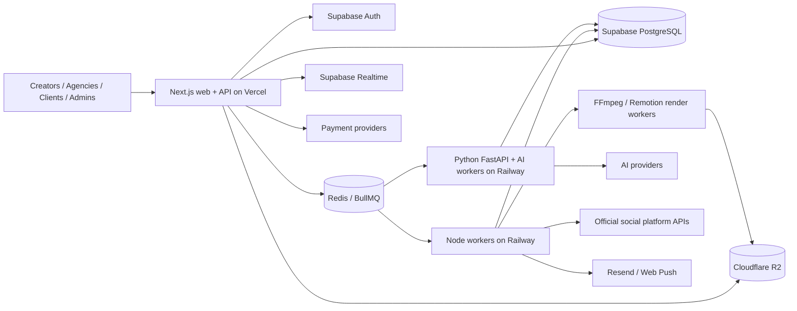

# Technical Architecture Document
## Autonomous AI Social Media Operating System
**Version:** 1.0 — Architecture proposal for design approval  
**Date:** 9 November 2026  
**Status:** Proposed; not implemented or tested

## 1. Executive architecture decision
Build a **workspace-first modular monolith** for the main product using Next.js App Router and TypeScript, with independently deployed background workers and a Python FastAPI AI service. The platform serves both individual creators and agencies from day one, including client login and content approval. Autonomous agents coordinate research, licensed clipping, editing, scheduling, publishing, and optimization within explicit user permissions and budgets.

**Architecture principles:** approved UI is the design contract; durable state lives in PostgreSQL; background work is not tied to browser sessions; external platform APIs are treated as capability- and approval-dependent; licensing and client approval are hard publishing gates; no unverified success states; observability and usage accounting are built in.

## 2. System context and component boundaries



**Deployment boundaries:**
- **Vercel:** Next.js pages, lightweight route handlers, authenticated UI and short synchronous requests. No persistent queues or long video rendering in serverless handlers.
- **Railway:** FastAPI, Node/BullMQ workers, schedulers, FFmpeg/Remotion workers initially. Separate resource limits and deployments by workload; move high-volume rendering to dedicated CPU/GPU infrastructure when measurements justify it.
- **Supabase:** managed PostgreSQL, Auth, Realtime; Prisma is the primary application ORM. Supabase Auth identities map to application user records.
- **Redis Cloud (BullMQ-compatible):** queues, leases and retries; not the source of truth for business state.
- **Cloudflare R2:** uploaded originals, authorized source assets, intermediate artifacts, final exports, thumbnails; database stores metadata and object keys.
- **Resend and Web Push:** email and browser push. Web Push requires HTTPS, service worker registration, user consent, and VAPID keys.

## 3. Repository layout

```text
apps/
  web/                  # Next.js App Router, route handlers, UI
  worker/               # Node/TypeScript BullMQ consumers and scheduler
services/
  ai/                   # Python FastAPI + agent/analysis tasks
  renderer/             # FFmpeg/Remotion rendering worker(s)
packages/
  db/                   # Prisma schema, migrations, typed access
  domain/               # Types, validation, permissions, events
  integrations/         # Social, payments, notifications adapters
  ui/                   # Shared approved design system
infra/
  docker-compose.yml
  deployment/
docs/
  PRD.md
  ARCHITECTURE.md
  API.md
  LICENSING.md
  RUNBOOKS.md
  FEATURE_COMPLETENESS.md
```

**Implementation note:** Keep server-only code out of client bundles; use Zod for TypeScript API input validation and Pydantic in FastAPI. Prefer OpenAPI for FastAPI and typed contracts for internal endpoints. Authenticate service-to-service requests and use least-privilege credentials.

## 4. Identity, tenants and roles

**Hierarchy:** `User → Organization → Workspace → Social Account / Agent / Content / Billing Allocation`. A solo creator receives one default organization and workspace; an agency may own multiple client workspaces. Each workspace has a stable owner organization and explicit memberships.

**Initial roles:** Platform Admin (separate global permission); Organization Owner; Organization Admin; Workspace Manager; Editor; Analyst/Viewer; Client Approver. A client can sign in and see only explicitly assigned workspace content and approval requests. Client approvers cannot alter publishing credentials or budgets unless granted an additional role.

**Security rules:** enforce authorization in every API route and worker, not just UI; workspace-scoped queries must include tenant boundaries; use database row-level security for any direct Supabase client access, otherwise keep Prisma access server-side with explicit tenancy checks. Log invitations, permission changes, approvals, publishing and sensitive settings changes. Test cross-tenant denial.

## 5. Data model (initial logical entities)

| Domain | Core tables/entities |
|---|---|
| Identity | User, Organization, OrganizationMembership, Workspace, WorkspaceMembership, Invitation |
| Accounts | SocialConnection, SocialAccount, OAuthTokenReference, ProviderCapability |
| Agents | Agent, AgentPolicy, AgentRun, AgentStep, AgentTask, AgentEvent, AgentBudget |
| Strategy | ContentGoal, StrategyPlan, ContentIdea, CalendarEntry |
| Media | MediaAsset, SourceVideo, Transcript, ClipCandidate, VideoProject, EditRevision, RenderJob, Export |
| Rights | CreatorProfile, CreatorChannel, OwnershipVerification, LicenseAgreement, PermissionEvidence, SourceRightsSnapshot, RightsRevocation |
| Publishing | ContentPost, PostDestination, ApprovalRequest, ApprovalDecision, PublishJob, PublishAttempt, ExternalPost |
| Collaboration | Comment, ActivityLog, AuditEvent |
| Notifications | Notification, NotificationPreference, PushSubscription, DeliveryAttempt |
| Billing | Plan, Subscription, UsageMeter, CreditLedger, ProviderCostRecord, PaymentEvent |
| Analytics | MetricSnapshot, PostPerformance, Insight, Experiment |
| Reliability | OutboxEvent, IdempotencyKey, WebhookReceipt, JobFailure |

**Data rules:** use immutable audit/credit ledger records; timestamps in UTC with user/workspace time zones stored separately; explicit state enums; soft-delete where retention obligations require it; encrypted OAuth token material and secrets; index workspace ID, state, scheduled time, and foreign keys. Never store raw video binaries in PostgreSQL.

## 6. Core application APIs

- `/api/auth/*` — session integration and identity hooks.
- `/api/workspaces/*` — workspace lifecycle, memberships, invitations, client access.
- `/api/social-connections/*` — OAuth initiation/callback, account metadata, disconnect.
- `/api/agents/*` — create/configure/start/pause/resume and runs/events.
- `/api/strategies/*` — goals, proposals, activation approval.
- `/api/media/*` — signed uploads, metadata, authorized source selection.
- `/api/projects/*` — clip candidates, revisions, previews and renders.
- `/api/approvals/*` — requests, decisions, comments and history.
- `/api/posts/*` — drafts, schedules, destinations, publish status.
- `/api/notifications/*` — inbox, preferences, push subscriptions.
- `/api/analytics/*` — supported metrics, freshness timestamps.
- `/api/billing/*` — plan, usage, credits, verified webhooks.
- `/api/admin/*` — guarded operational actions.

All mutation endpoints validate authorization, enforce idempotency where needed, and return stable resource IDs. Never return provider secrets. Pagination, filtering and rate limits are required for high-volume endpoints.

## 7. Autonomous agent orchestration

**Roles:** AI Strategist proposes goals, schedules and budgets; niche Content Agents research and generate; Rights Validator verifies licensing; Quality Inspector checks output; Publisher submits approved content; Analytics Optimizer recommends revisions. These are logical capabilities, not necessarily separate long-lived processes.

**Agent state machine:** `draft → awaiting_activation → active → paused → stopped`, with each run `queued → running → awaiting_approval | completed | failed | cancelled`. Agent steps record attempts and checkpoints. Use LangGraph where its durable workflow features help; persist authoritative run and approval state in PostgreSQL.

**Execution:** user-approved policy → scheduled trigger → BullMQ job → worker fetches current policy → research → rights gate → content plan → clipping/generation → QA → approval gate (if required) → schedule → provider capability/credential check → publish → verified outcome → analytics sync. Each expensive step checks remaining credits and budget before dispatch. A global or workspace emergency pause stops new dispatch and cancels cooperative tasks where possible; it cannot undo already published posts.

**Safety:** no open-ended spending; no arbitrary web scraping where prohibited; respect source and platform terms; no autonomous publishing to unapproved accounts; record model inputs/outputs with privacy-aware retention; avoid duplicate publishes through idempotency keys and provider reconciliation.

## 8. Video processing pipeline

1. Browser requests an authorized, short-lived multipart upload URL.
2. Browser uploads directly to R2; backend verifies size, MIME type and media probe.
3. Create media record and enqueue processing.
4. FFmpeg extracts audio/proxies; transcription and scene analysis produce timestamped candidates.
5. Ranking/clip selection records source timestamps, rights snapshot, and scoring rationale.
6. Editor saves non-destructive revision instructions (cuts, crop, captions, overlays, soundtrack).
7. Renderer creates preview then final output via FFmpeg/Remotion; upload to R2.
8. QA checks media integrity, duration, caption placement and rights before marking ready.

Use per-job temporary storage with cleanup, limits on source length/file size, malware scanning where feasible, content moderation policies, and quotas. Avoid promising precise viral scores; label predictive scores as estimates. Track licensed music and embedded third-party footage separately from video owner permission.

## 9. Licensing and rights enforcement

A public video URL is **not** proof of clipping rights. A channel enters `approved` only after evidence is validated for the intended use. Record the exact licensed asset or channel scope, commercial rights, edits, platforms, territories, attribution, expiry, revocation and third-party restrictions. Rights checks occur before ingestion/use and again before publishing. On expiry/revocation, block new jobs and scheduled publishes; flag existing published posts for review and takedown workflows where required. Creator portal supports ownership verification, permission management, audit history and usage visibility. Legal review is needed for the actual license agreement and jurisdictional requirements.

## 10. Social publishing and analytics

Use official OAuth and platform APIs only. Build one adapter per platform with explicit capability flags for upload, scheduling, metadata, account type, analytics, rate limits and review requirements. Initial targets: YouTube, Instagram, TikTok, Facebook; each goes live only when credentials, app review, account eligibility and API permissions are verified. Unsupported destinations show an honest disabled/pending state.

**Publish states:** `draft → needs_approval → approved → scheduled → queued → uploading → published | failed | unknown`. A network timeout after upload may mean `unknown`, not automatically `failed`; reconcile with provider before retrying to prevent duplicate posts. Store provider IDs, attempts and error codes. Analytics only display metrics actually returned by authorized APIs, with last-updated timestamps.

## 11. Agency client approval model

Approval requests are tied to a specific content revision and destination(s). Agency editors submit; assigned client approvers receive in-app/web-push/email notices and can preview, comment, approve, reject, or request changes. Any material edit after approval invalidates the old approval unless policy explicitly permits it. Publishing workers verify the current revision, current approval, active license, allowed destination, and account authorization **immediately before publishing**. Every decision records actor, timestamp, revision and optional comment. Support configurable approval chains and deadlines; default to blocking on missing approval.

## 12. Notifications and AI Activity Center

Persist a domain event and outbox entry in the same database transaction as the business state change. An outbox dispatcher publishes notification and realtime events; consumers deduplicate by event ID. Notification channels: inbox (persistent), Supabase Realtime (live authorized workspace feeds), Web Push (permission-based), Resend (transactional email). Respect user preferences, quiet hours where configured, and unsubscribe rules; security-critical notices may follow distinct rules.

AI Activity Center displays agent states, recent events, approval queue, progress where measurable, estimated cost, actual metered usage, and links to outputs. On reconnect, fetch authoritative state before subscribing to realtime updates. Filter events by workspace and role. Do not fabricate percentage completion or publish success.

## 13. Queue and scheduler design

Separate BullMQ queues: `research`, `transcribe`, `analyze`, `render`, `publish`, `analytics`, `notify`, `rights-recheck`, `maintenance`. A durable scheduler registers recurring jobs in UTC, preserving workspace timezone and daylight-saving semantics. Use backoff, max attempts, concurrency/rate controls, dead-letter inspection, idempotent handlers and poison-job alerts. Ensure the chosen Redis service supports BullMQ connection and command requirements. Use worker leases/heartbeats and DB checkpoints; queue durability alone is not sufficient for exact-once effects.

## 14. Billing, budgets and payment rails

Use subscriptions plus metered credits. Define chargeable units by operation (transcription minutes, rendering minutes, model tokens, generation requests, storage/retention). Keep an append-only credit ledger with reservations before expensive tasks, settlement after usage and refunds on qualifying failures. Set hard per-agent and workspace budget caps. Integrate a payment provider via signed webhooks and idempotent processing; evaluate Paystack/Flutterwave/Stripe based on business eligibility, supported currencies and recurring billing requirements. Pricing amounts are **not yet decided** and must be approved before implementation of public plans.

## 15. Reliability, security and privacy

- Supabase Auth with secure sessions, MFA options for privileged users, verified invitations.
- Encrypted OAuth tokens, scoped provider permissions, refresh/revocation handling.
- Signed R2 URLs, upload size/type validation, private buckets by default.
- Tenant isolation enforced at API and job layers; RLS for direct client DB access.
- CSRF protection as applicable, input validation, CSP, rate limits, webhook signature checks.
- Secret rotation, audit trails, vulnerability scanning and dependency updates.
- Database backup/restore drills; RPO/RTO targets to be approved; lifecycle retention and deletion requests.
- Sentry, structured logs, trace IDs, queue depth, processing latency, API failures, per-provider spend and alerting.
- Legal/privacy review for creator content, personal data, consent, retention, international transfers and platform rules.

## 16. Local development and environments

**Local:** Next.js, PostgreSQL, Redis, FastAPI, Node worker, renderer via Docker Compose (Next.js may run on host). Provide `.env.example`, seed data, mock social providers explicitly labeled as mocks, and test media fixtures. Never require production tokens for ordinary unit tests.

**Environments:** development, staging, production. Separate Supabase projects, Redis instances/namespaces, R2 buckets, payment test/live credentials and OAuth apps as needed. CI runs lint, typecheck, migrations validation, unit/integration tests and selected end-to-end tests. Production deploy uses migration and rollback procedures; feature flags protect unapproved integrations.

## 17. Milestone delivery plan and exit criteria

| Milestone | Deliverable | Exit evidence |
|---|---|---|
| M1 Foundation | Auth, creator/agency onboarding, workspaces, invites, roles, client login | Cross-tenant access tests; invite and approval-role tests |
| M2 Content | Authorized upload, transcript, clipping, captions, preview/edit/export | One real video processed end-to-end; rights metadata retained |
| M3 Publishing | Social OAuth adapters, approval queue, scheduling, notifications, Activity Center | Approved revision publishes to one verified provider; client receives notice; retry tested |
| M4 Autonomy | Agent policies, Strategist proposals, persistent runs, budgets, pause | Agent runs while browser closed; respects approval and spending gates |
| M5 Commercial | Billing, analytics, creator portal, admin, observability, deployment | Payment webhook tests, recovery drill, operational runbooks, staged load test |

**First vertical slice:** agency owner creates workspace → invites client approver → editor uploads licensed video → AI generates short → client approves exact revision → post scheduled → supported provider confirms publication → notifications and Activity Center update. This validates the product's differentiating creator-and-agency workflow early.

## 18. Acceptance tests (must be executable)

1. Creator and agency onboarding both work, with distinct but shared backend flows.
2. An agency can create multiple isolated client workspaces and invite a client approver.
3. Client approver sees only assigned content and cannot access unrelated workspaces.
4. A rights-restricted source cannot be rendered/published beyond its license scope.
5. An expired/revoked license blocks a pending scheduled publish.
6. A material revision after approval requires reapproval.
7. Browser closure does not stop queued agent/video jobs.
8. A worker restart resumes or safely retries without duplicate final outputs.
9. Publish timeout is reconciled before retry; no false success reported.
10. Agent pause prevents new tasks; budget limit blocks expensive dispatch.
11. Completed render generates persistent in-app notification, eligible web push and email.
12. Realtime Activity Center recovers accurate state after disconnect.
13. Webhooks reject invalid signatures and duplicate payment events.
14. A user cannot access another tenant's R2 objects through signed URL endpoints.
15. Monitoring alerts on queue backlog, repeated failures and unusual AI spend.

## 19. Open decisions before coding

**Must resolve:** (a) approved design/prototype and route inventory; (b) launch social provider(s) and verified API permissions; (c) billing plans, currencies and credit formula; (d) license agreement/legal review; (e) approval chain defaults and whether clients may approve per platform; (f) media retention limits; (g) initial AI/transcription/voice providers and per-job budgets; (h) target regions, privacy policy and data retention; (i) expected launch traffic and acceptable job wait times; (j) RPO/RTO and support response targets.

**Safe defaults pending approval:** one workspace for creators; agency workspaces isolated; client approval mandatory when client approver assigned; no autonomous publishing by default; no clip sourcing from unverified rights; provider adapters disabled until tested; usage caps enforced before task execution.

## 20. Handoff instructions to Claude

Treat the approved PRD and approved UI/UX as the product contract and this document as the architecture baseline. Before coding, produce a requirements-to-screen-to-API-to-data-to-test traceability matrix, identify conflicts and ask for approval on consequential choices. Implement milestones in order, keep `FEATURE_COMPLETENESS.md` accurate, run tests, and report verified functionality separately from mocks, incomplete integrations, and external approvals. Do not assert production readiness without security, reliability and provider-integration verification.
